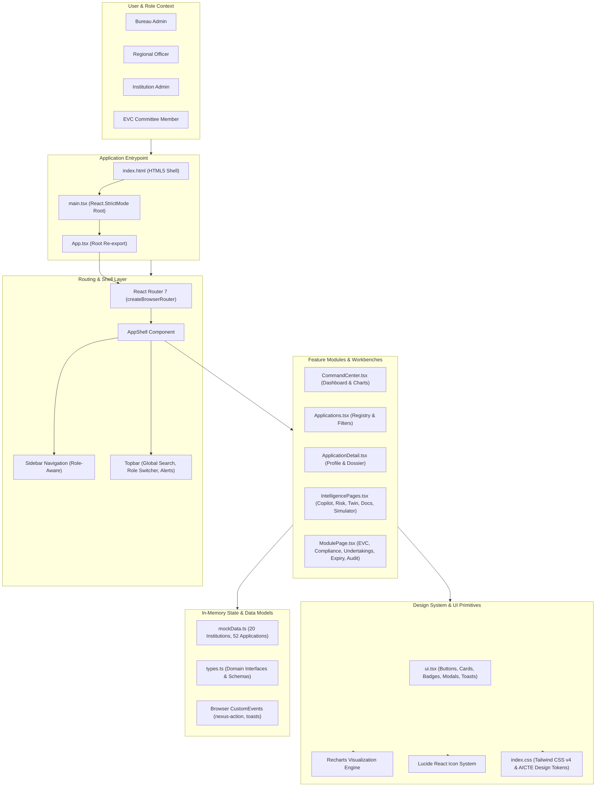
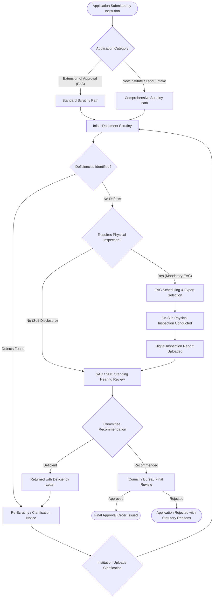

# AICTE NEXUS

**Next-Generation Regulatory Intelligence & Unified Approval System**

> *"From Application Processing to Predictive Regulatory Intelligence."*

[](https://react.dev/)
[](https://www.typescriptlang.org/)
[](https://vite.dev/)
[](https://tailwindcss.com/)
[](https://reactrouter.com/)
[](https://github.com/)

AICTE NEXUS is an integrated regulatory approval workflow, institutional compliance monitoring, document validity management, and regulatory intelligence platform designed to modernize technical education governance. Built with React 19, TypeScript, Vite, and Tailwind CSS v4, the system translates multidimensional statutory requirements into an actionable, role-tailored digital operating cockpit.

> **Regulatory Notice:** This project is an independent prototype developed with simulated institutional records and deterministic rule heuristics for demonstration purposes. It does not connect to live All India Council for Technical Education (AICTE) databases and does not claim official government affiliation or endorsement.

---

## Table of Contents

- [1. Project Overview](#1-project-overview)
- [2. Key Features](#2-key-features)
- [3. User Roles & Perspectives](#3-user-roles--perspectives)
- [4. Application Screenshots](#4-application-screenshots)
- [5. System Architecture](#5-system-architecture)
- [6. Application Approval Workflow](#6-application-approval-workflow)
- [7. Technology Stack](#7-technology-stack)
- [8. Project Directory Structure](#8-project-directory-structure)
- [9. Installation & Local Setup](#9-installation--local-setup)
- [10. Production Build & Preview](#10-production-build--preview)
- [11. Environment Configuration](#11-environment-configuration)
- [12. Sample Data Specifications](#12-sample-data-specifications)
- [13. Regulatory Safeguards & Human-in-the-Loop](#13-regulatory-safeguards--human-in-the-loop)
- [14. Prototype Scope & Limitations](#14-prototype-scope--limitations)
- [15. Future Scope & Roadmap](#15-future-scope--roadmap)
- [16. Contributing](#16-contributing)
- [17. License](#17-license)

---

## 1. Project Overview

Technical education governance requires balancing institutional growth with rigorous statutory oversight. In traditional regulatory processing, regulatory bureaus face distinct operational challenges:

- **Stage-Wise Pendency Bottlenecks:** Applications stall across multi-tier stages (Scrutiny, Re-scrutiny, EVC, SAC/SHC) without automated velocity visibility.
- **Expert Visit Committee (EVC) Coordination:** Complex logistical scheduling between external experts, regional officials, and institutional premises.
- **Time-Bound Compliance Tracking:** Critical undertakings, land lease renewals, and safety certificates (Fire, Structural, Building NOCs) risk lapsing undetected.
- **Fragmented Visibility:** Regulatory teams lack a centralized operational picture connecting geographic regional performance with individual application risk.

**AICTE NEXUS** addresses these challenges by consolidating regulatory intelligence into a single cohesive interface. The platform bridges document-level scrutiny with macro-level bureau oversight, offering real-time workload heatmaps, automated risk factor breakdowns, scenario-based capacity simulation, and an advisory AI compliance copilot.

---

## 2. Key Features

The platform implements 18 distinct functional regulatory modules:

| # | Feature Module | Implemented Capabilities |
| :--- | :--- | :--- |
| **01** | **Regulatory Command Center** | National dashboard with real-time application KPIs, processing velocity indicators, pendency trendlines, regional performance matrices, and urgent SLA alert feeds. |
| **02** | **Role-Based Access Experience** | Instant topbar role switcher toggling views between Bureau Admin, Regional Officer, Institution Admin, and EVC Committee members. |
| **03** | **End-to-End Approval Workflows** | Configurable, stage-by-stage progression tracking with status tags (`Approved`, `Pending`, `Returned`, `Overdue`). |
| **04** | **Application Tracking & Scrutiny** | Comprehensive registry with multi-column filtering (region, stage, status, category), search, pagination, and detailed dossier views. |
| **05** | **EVC Scheduling & Monitoring** | Calendar-aligned inspection management, expert team roster assignments, visit milestones, and inspection report ingestion. |
| **06** | **AI Compliance Copilot (NEXUS Intelligence)** | Natural-language query interface with citation-backed regulatory research referencing Approval Process Handbook (APH) clauses. |
| **07** | **Predictive Risk Intelligence** | Composite risk engine ranking applications on weighted factors: stage ageing, deadline proximity, officer workload, and missing clarifications. |
| **08** | **AI Document Intelligence Workbench** | Dual-pane interface comparing uploaded deed/NOC text side-by-side with self-declared institutional entries, highlighting discrepancies. |
| **09** | **Institution Digital Twin** | 360-degree institutional profile monitoring statutory compliance scores, document validity rates, active alerts, and historical approval milestones. |
| **10** | **Workflow Simulation Lab** | Interactive scenario simulator allowing officers to model staffing, application volume surges, and EVC availability to forecast pipeline bottlenecks. |
| **11** | **Institutional Compliance Management** | Tracking mandatory regulatory parameters: faculty cadre ratios, built-up instructional area, computing facilities, and barrier-free access. |
| **12** | **Undertakings & Affidavits Tracking** | Monitoring of statutory affidavits, anti-ragging undertakings, fee structure adherence, and compliance declarations. |
| **13** | **Lease & Document Expiry Monitoring** | Proactive countdown tracker for land lease agreements, fire safety certificates, and building stability permits with escalation thresholds. |
| **14** | **Notification & Escalation Center** | Prioritized SLA alerts, deadline breach warnings, and automated supervisory escalation triggers. |
| **15** | **Regulatory Change Impact Analyzer** | Clause-by-clause comparison tool evaluating the impact of annual APH rule updates on active applications. |
| **16** | **Analytics & Operational Reporting** | Interactive data visualizations: monthly pendency trends, regional throughput distribution, and exportable CSV/text briefing summaries. |
| **17** | **Complete Audit Trail** | Chronological, immutable activity timeline recording officer actions, status transitions, clarifications, and document uploads. |
| **18** | **Administration & Configuration** | Governance panels for managing user permissions, regional office mappings, regulatory rule parameters, and system preferences. |

---

## 3. User Roles & Perspectives

The application provides a built-in role switcher in the top navigation bar to evaluate user journeys across four primary regulatory roles:

```
[ Bureau Admin ] ◄════════════► [ Regional Officer ]
       ▲                               ▲
       ║                               ║
       ▼                               ▼
[ Institution Admin ] ◄═══════► [ EVC Committee Member ]
```

1. **Bureau Admin (Central Headquarters):**
   - National operational oversight across all 8 AICTE regions.
   - High-level KPI monitoring, policy configuration, capacity simulation, and final council approval dispatch.
2. **Regional Officer (Northern, Western, Southern, Eastern, Central, etc.):**
   - Regional application queue management, initial scrutiny assignments, defect letter issuance, and local EVC dispatching.
3. **Institution Admin (College / University Leadership):**
   - Institution-specific dashboard, application status tracking, document upload dossiers, deficiency responses, and compliance alerts.
4. **EVC Committee Member (Inspection Expert):**
   - Scheduled inspection itinerary, on-site physical infrastructure checklist, deficiency reporting, and formal inspection recommendations.

---

## 4. Application Screenshots

The following screenshots depict the actual AICTE NEXUS interface running locally in standard production mode:

### A. Regulatory Command Center

The executive command cockpit provides full operational visibility over national technical education approvals, regional pendency, and real-time alerts.


*Figure 1: Regulatory Command Center — Operational overview, live KPIs, and the multi-stage approval lifecycle track.*


*Figure 2: Pendency Analytics & Regional Grouping — Monthly intake trendlines, stage distributions, and regional throughput matrix.*


*Figure 3: Critical Attention Required & Operational Audit Feed — Prioritized SLA breach risks, lease expiries, and recent activity logs.*

---

### B. AI Intelligence & Decision Support

Explainable AI tools empower regulatory officers to detect risks proactively and research complex Approval Process Handbook (APH) regulations with source citations.


*Figure 4: AI Compliance Copilot (NEXUS Intelligence) — Conversational research workbench citing simulated source records and policy clauses.*


*Figure 5: Predictive Risk Intelligence — Algorithmic risk ranking with transparent factor contribution percentages and suggested interventions.*

---

### C. Compliance Intelligence & Institutional Health

Comprehensive digital twins track institutional compliance over time, connecting physical land metrics, certificates, and inspection history.


*Figure 6: Institution Digital Twin — 360-degree compliance scoring, document validity index, active alerts, and historical timeline.*

---

### D. Workflow Simulation & Capacity Planning

Interactive forecasting tools allow bureau administrators to simulate regulatory workload shifts and plan resource allocation.


*Figure 7: Workflow Simulation Lab — Parametric scenario assumptions modeling officer capacity against projected application pendency.*

---

### E. Operational Reporting & Analytics

Filtered registries allow regional officers to inspect, sort, and export institutional application queues with fine-grained status tracking.


*Figure 8: Analytics & Insights — Searchable application registry with regional filtering, responsible actor assignments, and status indicators.*

---

## 5. System Architecture

AICTE NEXUS is engineered as a responsive, client-side React 19 application utilizing an in-memory regulatory data model, modular presentation components, and an accessible Tailwind CSS v4 design system:



### Architectural Layer Details:
1. **Client & Shell Layer:** Manages role-aware sidebar visibility, topbar notifications, global application search, and active route highlighting.
2. **Feature Modules:** Individual workbench views implemented as modular React components without circular imports.
3. **Design System:** Custom AICTE palette configured via CSS custom properties (`--forest`, `--gold`, `--clay`, `--sand`) paired with Tailwind CSS v4 utility classes.
4. **Data & State Layer:** In-memory deterministic dataset maintaining 20 fictional institutions and 52 linked application records, supporting real-time client-side sorting, filtering, and tab transitions.

---

## 6. Application Approval Workflow

The platform maps the regulatory lifecycle across configurable scrutiny and inspection pathways based on the institutional application category:



---

## 7. Technology Stack

| Layer | Technology | Version | Purpose in AICTE NEXUS |
| :--- | :--- | :--- | :--- |
| **Frontend Framework** | React | `^19.0.0` | Declarative UI rendering in React Strict Mode |
| **Runtime Environment** | React DOM | `^19.0.0` | Browser DOM mounting and element lifecycle |
| **Language** | TypeScript | `^5.7.0` | Static typing, interface definitions, and compile checks |
| **Build Tool & Dev Server** | Vite | `^8.0.5` | Fast local HMR development server and Rollup bundling |
| **CSS & Design System** | Tailwind CSS | `^4.0.0` | Utility-first styling with `@tailwindcss/vite` plugin |
| **Routing** | React Router | `^7.9.6` | Client-side routing with `createBrowserRouter` |
| **Data Visualizations** | Recharts | `^3.10.1` | Pendency trends, regional throughput, and stage donut charts |
| **Iconography** | Lucide React | `^1.65.0` | High-fidelity UI icons for regulatory workflows |
| **Code Formatting** | oxfmt | `^0.2.0` | High-performance source code formatting |
| **Package Management** | pnpm | `^10.34.0` | Fast, deterministic, space-efficient dependency management |

---

## 8. Project Directory Structure

```text
AICTE-NEXUS/
│
├── images/                               # Real application screenshots for repository documentation
│   ├── Screenshot 2026-10-30 210749.png  # Command Center (Executive Overview & Pipeline)
│   ├── Screenshot 2026-10-30 210815.png  # Analytics & Insights Registry Table
│   ├── Screenshot 2026-10-30 210851.png  # Workflow Simulation Lab (Interactive Forecasting)
│   ├── Screenshot 2026-10-30 210904.png  # Institution Digital Twin (Compliance Overview)
│   ├── Screenshot 2026-10-30 210915.png  # Predictive Risk Intelligence (Factor Breakdown)
│   ├── Screenshot 2026-10-30 210938.png  # AI Compliance Copilot (NEXUS Intelligence Chat)
│   ├── Screenshot 2026-10-30 211022.png  # Command Center (Pendency Trends & Regional Matrix)
│   └── Screenshot 2026-10-30 211136.png  # Command Center (Critical Attention & Audit Log)
│
├── public/                               # Static public assets
│   └── favicon.svg                       # Vector institutional platform mark
│
├── src/                                  # Application source code
│   ├── app/
│   │   ├── App.tsx                       # RouterProvider application root
│   │   └── routes.tsx                    # Route definitions and module mapping
│   ├── components/
│   │   ├── AppShell.tsx                  # Global shell (sidebar, topbar, role switcher)
│   │   └── ui.tsx                        # Shared UI primitives (buttons, badges, cards, modals, toast)
│   ├── data/
│   │   └── mockData.ts                   # Fictional institutions (20) and application records (52)
│   ├── pages/
│   │   ├── ApplicationDetail.tsx         # Comprehensive institutional application dossier
│   │   ├── Applications.tsx              # Filterable application registry
│   │   ├── CommandCenter.tsx             # Regulatory command center dashboard
│   │   ├── IntelligencePages.tsx         # Copilot, Risk, Digital Twin, Document Workbench, Simulator
│   │   └── ModulePage.tsx                # Generic layout for EVC, Scrutiny, Expiry, Compliance
│   ├── App.tsx                           # Re-export of src/app/App
│   ├── index.css                         # AICTE design tokens, color variables & component styles
│   ├── main.tsx                          # React entrypoint mounting to #root
│   ├── types.ts                          # Domain interfaces (Institution, Application, etc.)
│   └── vite-env.d.ts                     # Vite client type definitions
│
├── .env.example                          # Environment variable configuration template
├── .gitattributes                        # Git LFS tracking rules for binary assets
├── .gitignore                            # Comprehensive ignore rules for Node, Vite, OS, and IDEs
├── .mise.toml                            # Toolchain version specifications (Node 22, pnpm 10)
├── AGENTS.md                             # Internal development guide and architecture overview
├── CLAUDE.md                             # Agent guidance pointer
├── index.html                            # Clean HTML5 entrypoint with metadata and title
├── package.json                          # Package dependencies and npm execution scripts
├── pnpm-lock.yaml                        # Exact lockfile for reproducible package installation
├── tsconfig.json                         # TypeScript compiler configuration (ES2022 target)
├── vite.config.ts                        # Clean, independent Vite configuration
└── README.md                             # Comprehensive project documentation
```

---

## 9. Installation & Local Setup

### Prerequisites

Ensure the following tools are installed on your developer machine:

- **Node.js:** v18.0.0 or higher (Node.js LTS v20.x or v22.x recommended)
- **pnpm:** v10.0.0 or higher (or `npm` v10+)
- **Git:** v2.30+

Verify versions:
```bash
node --version
pnpm --version
git --version
```

### Step-by-Step Setup

1. **Clone the repository:**
   ```bash
   git clone <YOUR_GITHUB_REPOSITORY_URL>
   cd "Build AICTE NEXUS Platform"
   ```

2. **Install project dependencies:**
   ```bash
   pnpm install
   ```

3. **Start the local Vite development server:**
   ```bash
   pnpm dev
   ```

4. **Access the application:**
   Open your browser and navigate to:
   ```
   http://localhost:5173/
   ```
   Hot Module Replacement (HMR) is enabled; changes to source code will reflect immediately.

---

## 10. Production Build & Preview

To compile an optimized production distribution:

```bash
pnpm build
```

The output bundle is generated inside the `dist/` directory:
- `dist/index.html` — Clean HTML entry shell
- `dist/assets/index-[hash].css` — Optimized and purged Tailwind CSS bundle
- `dist/assets/index-[hash].js` — Minified production JavaScript bundle

To preview the production build locally:

```bash
pnpm preview
```

Vite will serve the compiled bundle at `http://localhost:4173/`.

---

## 11. Environment Configuration

The prototype operates entirely client-side and requires **no external API keys, database connection strings, or cloud services** to run.

An optional template file [`.env.example`](.env.example) is provided:

```env
# Optional: Port configuration for local Vite development server (default: 5173)
PORT=5173

# Optional: Base URL path if deploying to a subpath (default: /)
# VITE_BASE_URL=/
```

To configure optional variables:
```bash
cp .env.example .env
```

---

## 12. Sample Data Specifications

The prototype includes an in-memory dataset designed to simulate realistic technical education regulatory workflows without exposing real institutional records:

- **Fictional Institutions (20):** Representative universities, private engineering colleges, and government polytechnics located across Indian states and AICTE regions (Northern, Western, Southern, Eastern, Central, South Central, North Eastern).
- **Linked Application Records (52):** Diverse application numbers (`AP-2026-1001` through `AP-2026-1052`) capturing diverse approval types (*New Institution*, *Extension of Approval*, *New Course*, *Increase in Intake*), pendency durations, and risk tiers (*Low*, *Medium*, *High*, *Critical*).
- **Sample Documents:** Simulated land title deeds, municipal NOCs, and fire certificates for document verification workflows.

All institutional names, officer names, and document IDs are fictional and used exclusively for functional demonstration.

---

## 13. Regulatory Safeguards & Human-in-the-Loop

AICTE NEXUS adheres to strict ethical governance standards:

1. **Advisory AI Boundaries:** AI Copilot responses, risk scores, and document mismatch highlights are **strictly advisory**. AI systems cannot autonomously approve, reject, or penalize applications.
2. **Statutory Human Decision-Making:** Final regulatory determinations remain exclusively with authorized human officers, Scrutiny Committees, and Council boards.
3. **Mandatory Policy Citations:** AI insights explicitly reference relevant Approval Process Handbook (APH) clauses to enable human verification.
4. **Dual-Check Verification:** Any optical discrepancy between uploaded documents and portal declarations requires secondary manual verification before progression.
5. **Immutable Audit Trails:** Every status update, document verification, and scheduling action generates an audit entry recording the responsible officer and timestamp.

---

## 14. Prototype Scope & Limitations

To ensure transparency, the current prototype implementation includes the following boundaries:

- **Offline Prototype Architecture:** The application operates as a standalone single-page application (SPA). Simulated AI queries, risk models, and document OCR run on deterministic heuristics rather than external cloud APIs.
- **Session-Based State:** Application status transitions, approvals, and form inputs persist during the active browser session. Refreshing the browser resets data to the baseline mock state.
- **Simulated Authentication:** The role switcher allows instant demonstration of role-tailored views. Enterprise single sign-on (SSO) integration (e.g., Jan Parichay) is reserved for production deployment.

---

## 15. Future Scope & Roadmap

Planned enhancements for future production integration include:

- **Authorised AICTE API Integration:** Live synchronization with the national AICTE approval portal and ERP systems.
- **Jan Parichay & e-Pramaan SSO:** Multi-factor governmental authentication and role-based access control (RBAC).
- **Live Multimodal OCR:** Integration of high-throughput document OCR pipelines for physical title deeds and building blue-prints.
- **Machine Learning Risk Models:** Predictive models trained on multi-year longitudinal compliance datasets.
- **Automated Communication Hub:** Native SMS, email, and WhatsApp gateway integrations for statutory notices and reminder alerts.

---

## 16. Contributing

Contributions, bug reports, and suggestions are welcome. Please follow standard GitHub workflow conventions:

1. Fork the repository.
2. Create a descriptive feature branch:
   ```bash
   git checkout -b feature/regulatory-enhancement
   ```
3. Commit your changes with clear messages.
4. Ensure the production build passes:
   ```bash
   pnpm build
   ```
5. Submit a detailed Pull Request.

---

## 17. License

No open-source license has yet been specified for this repository. All rights are reserved by the repository owner and sponsoring authors. Distribution, commercial use, or modification is prohibited without prior written authorization.
